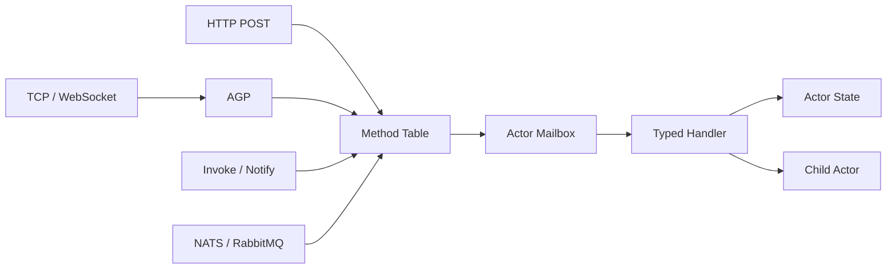

# ActorGo

> 专注游戏逻辑，并发交给 ActorGo。

ActorGo 是一个面向实时游戏服务端的 Go Actor 框架。它用 Actor 隔离业务状态，以稳定的 Method ID 描述调用契约，并让本地调用、AGP 长连接、HTTP 与集群调用共享同一套方法表。

[](https://pkg.go.dev/github.com/actorgo-game/actorgo)
[](https://goreportcard.com/report/github.com/actorgo-game/actorgo)
[](LICENSE)

[官网](https://1fun.net/) · [HTTP 文档](_docs/http-actor.md) · [AGP 协议](_docs/agp-protobuf-protocol-design.md)

## 为什么使用 ActorGo

- **状态归属清晰**：每个 Actor 是一份可变状态的唯一所有者。
- **默认串行执行**：方法调用进入单一 Mailbox，业务状态通常不需要共享锁。
- **入口契约统一**：AGP、HTTP、本地调用和跨节点调用都通过 Method ID 路由。
- **类型在注册时校验**：Handler 只允许两种签名，错误尽早暴露在 `OnInit`。
- **从单机平滑扩展**：业务代码保持不变，按部署需要切换 NATS 或 RabbitMQ 集群传输。
- **面向实时连接**：内置 TCP、WebSocket、会话、心跳、取消、超时、服务端推送和优雅停机。
- **组件化生命周期**：HTTP、Gin、Redis、MongoDB、GORM、Cron、配置热更新和诊断能力可以按需注册。

## 运行模型



外部调用只提交 Method ID 和 Body。Method Table 定位顶层 Actor，Mailbox 负责串行化执行，Handler 只修改自己拥有的状态。动态子 Actor 的完整 ActorPath 仅供服务端内部路由使用。

## 快速开始

### 1. 环境与安装

当前模块要求 Go `1.26.1` 或更高版本。

```bash
go get github.com/actorgo-game/actorgo@latest
```

### 2. 定义第一个 Actor

```go
package main

import (
    cfacade "github.com/actorgo-game/actorgo/facade"
    cactor "github.com/actorgo-game/actorgo/net/actor"
)

const LoginMethodID uint32 = 1001

type LoginRequest struct {
    Account string `json:"account"`
}

type LoginResponse struct {
    PlayerID int64  `json:"player_id"`
    Nickname string `json:"nickname"`
}

type PlayerActor struct {
    cactor.Base
}

func (*PlayerActor) AliasID() string { return "player" }

func (a *PlayerActor) OnInit() {
    a.Methods().Register(LoginMethodID, a.Login)
}

func (a *PlayerActor) Login(
    _ *cfacade.RequestContext,
    request *LoginRequest,
) (*LoginResponse, error) {
    return &LoginResponse{
        PlayerID: 10001,
        Nickname: request.Account,
    }, nil
}
```

业务 Method ID 必须大于 `5`。`1` 到 `5` 由握手、心跳、取消、GoAway 和 Kick 等系统消息保留；所有顶层 Actor 的 Method ID 必须全局唯一。

### 3. 准备节点配置

创建 `config/profile.json`：

```json
{
  "env": "dev",
  "debug": true,
  "print_level": "debug",
  "node": {
    "1": [
      {
        "node_id": "^\\d+$",
        "address": "127.0.0.1:9000",
        "rpc_address": "",
        "enabled": true,
        "__settings__": {
          "node_name": "game"
        }
      }
    ]
  }
}
```

示例启动参数 `1.1.1.1` 依次表示大区、小区、节点类型和节点实例；这里的配置键 `"1"` 对应节点类型。

### 4. 启动 HTTP Actor 服务

```go
package main

import (
    "github.com/actorgo-game/actorgo"
    cfacade "github.com/actorgo-game/actorgo/facade"
    "github.com/actorgo-game/actorgo/net/httpactor"
)

func main() {
    app := actorgo.Configure(
        "./config/profile.json",
        "1.1.1.1",
        actorgo.Standalone,
    )

    app.SetDefaultBodyCodec(cfacade.CodecJSON)
    app.AddActors(&PlayerActor{})
    app.Register(httpactor.NewComponent(
        "actor-api",
        "127.0.0.1:9080",
    ))

    app.Startup()
}
```

`Startup` 会阻塞运行，收到 `SIGINT`、`SIGQUIT` 或 `SIGTERM` 后按组件注册顺序的逆序关闭。

### 5. 发起第一个请求

```bash
curl -X POST "http://127.0.0.1:9080/actor/1001" \
  -H "Content-Type: application/json" \
  -H "X-ActorGo-Timeout-Ms: 3000" \
  -d '{"account":"demo"}'
```

成功响应：

```json
{"player_id":10001,"nickname":"demo"}
```

Request 方法成功返回 HTTP `200`；Notify 方法成功入队后返回 `202`。错误响应使用统一的 `HTTPError` 结构。

## Handler 与 Method Table

Actor 方法只支持两种签名：

```go
// Request：需要响应
func(ctx *cfacade.RequestContext, request *Request) (*Response, error)

// Notify：单向消息
func(ctx *cfacade.RequestContext, request *Request) error
```

注册行为有以下约束：

- 只能在 Actor 的 `OnInit` 中调用 `Methods().Register`。
- 第二个参数必须是请求指针。
- Request 与 Response 必须同时为普通 Go 结构体，或同时实现 `proto.Message`。
- 重复 Method ID、非法签名等注册错误会触发 panic，并由 Actor 创建流程转换为创建失败。
- 顶层 Actor 方法会写入 Application Method Table；子 Actor 方法只安装到自己的 Mailbox，不对外暴露。

## RequestContext

每个入口都会构造同一类型的请求上下文：

| 字段 | 说明 |
| --- | --- |
| `Context` | 取消信号与截止时间；跨节点时继续传递剩余预算 |
| `RequestID` | 请求关联 ID |
| `Transport` | `AGP`、`HTTP` 或 `Cluster` |
| `Codec` | 当前业务 Body 使用 Protobuf 或 JSON |
| `Session` | 连接与玩家快照：Sid、Uid、IP、Data |
| `Metadata` | Trace ID 等可透传元数据 |

框架在跨 Mailbox 和跨节点边界时复制可变的 Session 与 Metadata，避免并发共享同一份 map。

## Actor 调用 API

| 调用 | 语义 | 使用场景 |
| --- | --- | --- |
| `Invoke(ctx, methodID, payload)` | 本节点 Request | 等待另一个顶层 Actor 返回结果 |
| `Notify(ctx, methodID, payload)` | 本节点 Notify | 单向投递给顶层 Actor |
| `InvokeNode(ctx, nodeID, methodID, payload)` | 跨节点 Request | 调用指定节点的顶层 Actor |
| `NotifyNode(ctx, nodeID, methodID, payload)` | 跨节点 Notify | 单向投递到指定节点 |
| `InvokeChild(ctx, childID, methodID, payload)` | 本节点子 Actor Request | 父 Actor 调用自己的动态子 Actor |
| `NotifyChild(ctx, childID, methodID, payload)` | 本节点子 Actor Notify | 父 Actor 单向投递给自己的子 Actor |
| `InvokeTarget` / `NotifyTarget` | 完整 ActorPath | 服务端内部的显式路由 |

`Invoke` 返回 `*cfacade.InvokeResult`。同进程成功结果通常是具体响应对象；跨节点结果是编码后的字节，可使用统一的 `Decode` 方法：

```go
ctx := cfacade.NewRequestContext(context.Background())
ctx.Codec = cfacade.CodecJSON

targetNodeID := "18014467229220866" // 示例：节点参数 1.1.1.2
result := app.ActorSystem().InvokeNode(ctx, targetNodeID, LoginMethodID, request)
if !result.OK() {
    return fmt.Errorf("actor invoke failed: code=%d message=%s", result.Code, result.Message)
}

response := new(LoginResponse)
if err := result.Decode(app.BodyCodecs(), ctx.Codec, response); err != nil {
    return err
}
```

Actor 不允许同步 `Invoke` 自己，否则会形成 Mailbox 自死锁；单向自投递可根据业务设计谨慎使用 `Notify`。

## AGP 长连接

注册 AGP 服务组件即可同时开放 TCP 与 WebSocket：

```go
app.Register(parser.New("client", []cfacade.IConnector{
    connector.NewTCP(":9000"),
    connector.NewWS(":9001"),
}))
```

AGP 的设计边界：

- 外层 `Packet` 固定使用 Protobuf。
- 业务 Body 同时支持 Protobuf 与 JSON，由 `Packet.codec` 指定。
- TCP 帧格式为 `uint32 big-endian length + Packet`。
- WebSocket 每条 Binary Message 对应一个 Packet，并要求子协议 `agp.v1`。
- 客户端消息只有 Request、Response、Notify，不允许传入 ActorPath。
- 内置握手、心跳、请求取消、Kick、GoAway、连接限额和背压。
- 服务端可通过连接 ID 或 UID 执行 Notify、Broadcast 与 Kick。

完整协议见 [`net/proto/agp.proto`](net/proto/agp.proto) 与 [AGP 协议设计](_docs/agp-protobuf-protocol-design.md)。

## HTTP 接入

独立组件会开放固定路由：

```text
POST /actor/{methodID}
```

支持：

- `Content-Type: application/json`
- `Content-Type: application/x-protobuf`
- `X-ActorGo-Timeout-Ms` 请求超时
- 自定义 Authenticator，将身份写入 `RequestContext.Session`
- Trace Header 白名单透传
- 请求体大小、默认超时和最大超时限制

已有 Gin 服务时可以复用同一个 Handler：

```go
actorHandler := httpactor.NewHandler(app)
if err := httpServer.RegisterActorRoutes(actorHandler); err != nil {
    panic(err)
}
```

详见 [HTTP 调用 Actor](_docs/http-actor.md)。

## 集群与服务发现

使用 `actorgo.Cluster` 启动时，框架会自动注册 Cluster 与 Discovery 组件：

```go
app := actorgo.Configure(profilePath, nodeID, actorgo.Cluster)
```

| 能力 | 可选实现 | 说明 |
| --- | --- | --- |
| 集群传输 | NATS、RabbitMQ | 承载 Protobuf `ClusterMessage` 与 Request/Reply |
| 服务发现 | NATS、etcd | 维护节点成员与节点类型索引 |

默认 `cluster.mode` 为 `nats`；配置为 `rabbitmq` 后，业务仍然使用相同的 `InvokeNode` 与 `NotifyNode`。Discovery 与集群传输可以独立选择。

当前 NATS Core 与 RabbitMQ 实现面向低延迟、尽力投递的节点通信，不提供业务消息持久化语义。RabbitMQ 的拓扑、背压和配置见 [RabbitMQ 集群传输](_docs/rabbitmq-cluster.md)。

## Actor 内部能力

除了方法 Mailbox，每个 Actor 还拥有：

- `Child()`：创建、查找、遍历和移除动态子 Actor。
- `Event()`：按事件名和可选 Unique ID 订阅框架内事件。
- `Timer()`：一次性、周期、固定时间与自定义 Schedule 定时器。
- `Exit()`：排空已进入的 Mailbox 与 Event 工作后有序停止当前 Actor。

Handler、Event 与 Timer 都有异常保护。普通业务 Handler panic 会记录日志并转换为 `STATUS_INTERNAL`，不会直接停止该 Actor。

## 通用组件

仓库内置的组件位于 [`components/`](components/)：

| 组件 | 用途 |
| --- | --- |
| `gin` | HTTP Server、Controller、Middleware 与 Actor HTTP 路由 |
| `redis` | Redis 连接与分布式锁 |
| `mongo` | MongoDB 连接管理 |
| `gorm` | GORM / MySQL 访问 |
| `cron` | Cron 调度 |
| `data-config` | 本地或 Redis 配表、解析与热更新 |
| `gops` | 在线 Go 进程诊断 |

所有组件都遵循统一生命周期：`Set` → `Init` → `OnAfterInit` → `OnBeforeStop` → `OnStop`。

## 项目结构

```text
actorgo/
├─ facade/              公共接口、RequestContext、ActorPath 与 Codec
├─ net/actor/           Actor、Mailbox、Child、Event、Timer 与调用系统
├─ net/method/          Handler 签名适配与 Method Table
├─ net/parser/          AGP 连接、握手、请求分发与服务端推送
├─ net/connector/       TCP 与 WebSocket Connector
├─ net/httpactor/       HTTP 到 Actor 的适配层
├─ net/cluster/         NATS / RabbitMQ 集群传输
├─ net/discovery/       NATS / etcd 服务发现
├─ net/proto/           AGP 与 ClusterMessage Protobuf 定义
├─ components/          可选通用组件
├─ profile/             节点与环境配置
├─ logger/              日志系统
└─ _docs/               设计、协议与专题文档
```

## 开发与验证

验证核心运行时、协议与网络入口：

```bash
go test ./facade ./profile ./net/...
```

重新生成框架 Protobuf：

```bash
make init
make protoc
```

只验证核心网络链路：

```bash
go test ./net/proto ./net/serializer ./net/method \
  ./net/parser ./net/httpactor ./net/actor ./net/connector
```

`components/mongo` 的示例测试需要本地 MongoDB，`components/cron` 包含长期运行的调度示例，因此不包含在上述快速检查中。

## 文档

- [HTTP 调用 Actor](_docs/http-actor.md)
- [AGP 协议设计](_docs/agp-protobuf-protocol-design.md)
- [RabbitMQ 集群传输](_docs/rabbitmq-cluster.md)


## License

[MIT](LICENSE)
